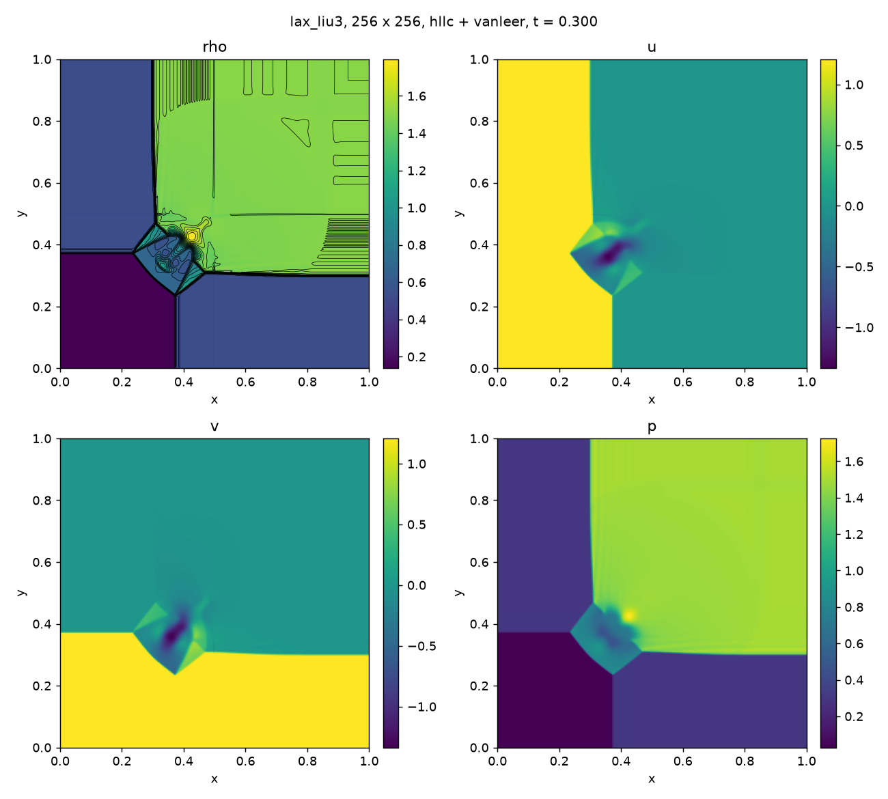
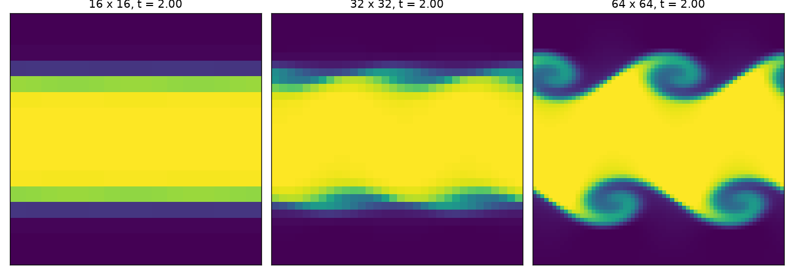
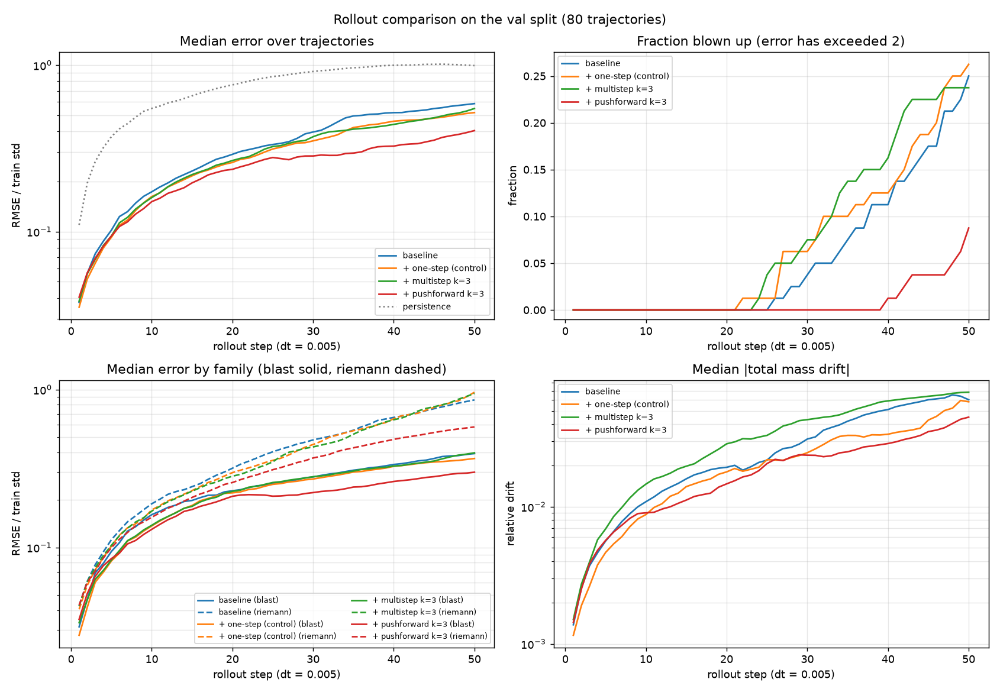
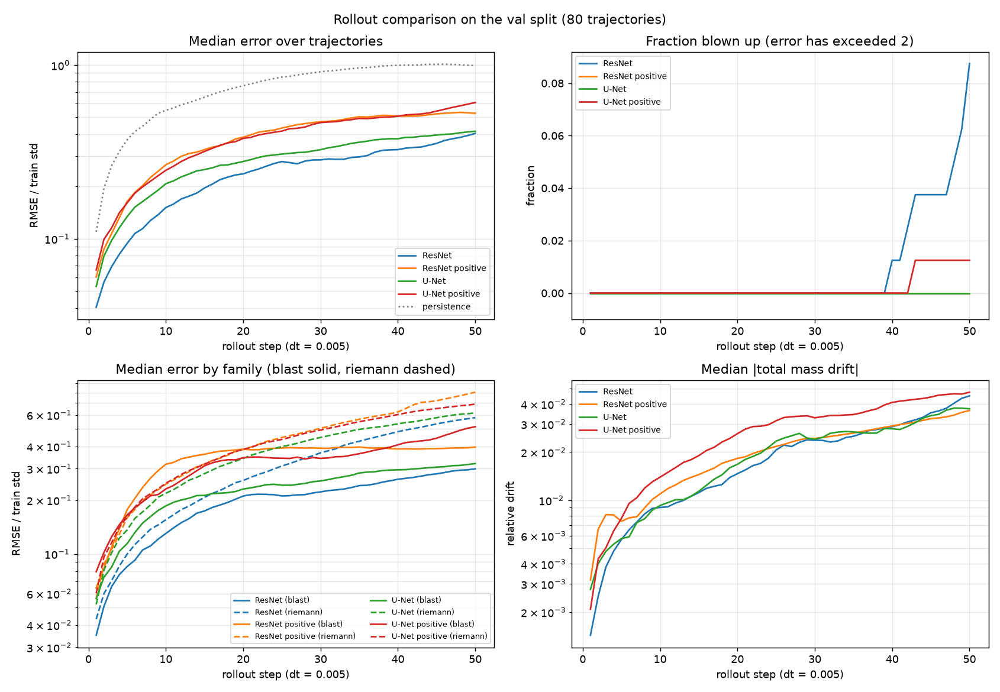
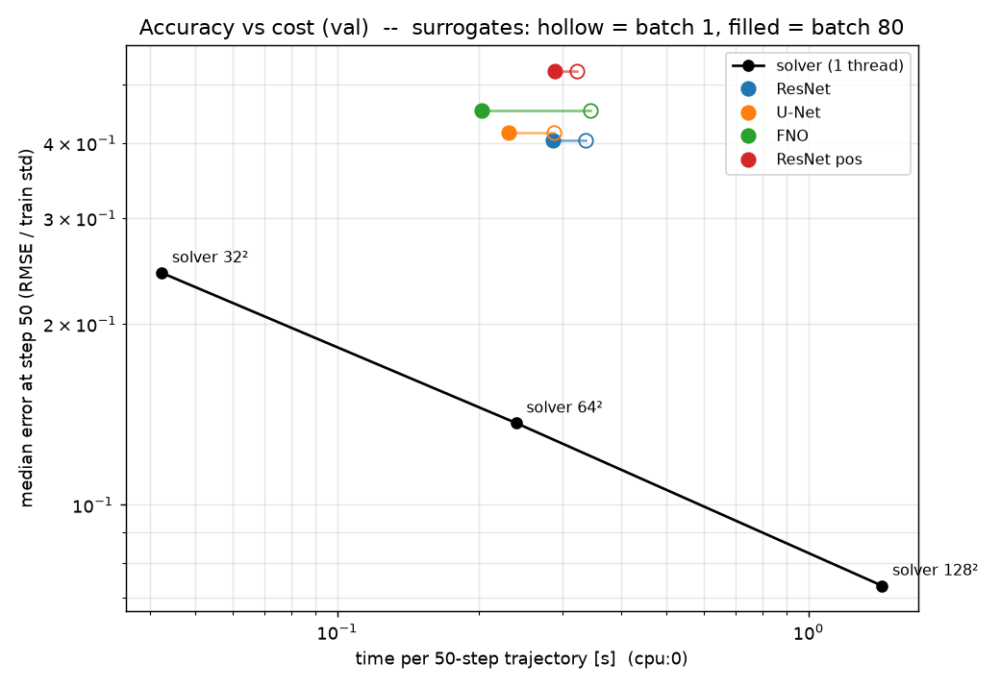

# Neural PDE Surrogates for Compressible Flow

**Can neural operators learn compressible flows with shocks — and when is a learned surrogate faster than a good numerical solver at equal accuracy?**

This project builds the whole pipeline needed to answer that question: a validated high-resolution finite-volume solver written from scratch in C++, a reproducible multi-resolution dataset generated with it, and neural surrogates in JAX evaluated against the solver on accuracy *and* cost.

Fourier Neural Operators truncate high-frequency modes, which should cause Gibbs-type ringing at shocks — the same problem slope limiters solve in classical schemes. Most surrogate papers also compare against a fine-resolution solver, which flatters the surrogate. Here the comparison is made at **matched accuracy**: the surrogate is compared with the coarse solver run that achieves the same error.

> **Status:** Phase 1 (solver + dataset) complete. Phase 2 (models) in progress: ResNet and U-Net baselines, pushforward training and a positivity-preserving variant evaluated; FNO next.

---

## Project plan

| Phase | Content | Status |
|---|---|---|
| **1. Solver & data** | 2D compressible Euler solver (C++), validation, OpenMP, profiling, dataset generator | ✅ solver · ✅ generator · ✅ dataset v0 (850 trajectories) |
| **2. Models** | FNO written from scratch, U-Net and ResNet baselines, autoregressive training in JAX, multi-GPU | ✅ baselines · ✅ pushforward · FNO |
| **3. Evaluation** | rollout error, conservation drift, shock position/width, spectral error, out-of-distribution test, super-resolution, accuracy-vs-cost Pareto front | ⬜ |
| **4. Stretch** | fused spectral-conv kernel, conservative projection, hybrid solver + learned correction, PDEBench / The Well comparison | ⬜ |

---

## The solver

A second-order Godunov-type finite-volume method for the 2D Euler equations (γ = 1.4):

- **Riemann solvers:** HLLC (default) and Rusanov; y-faces use the rotation trick so one 1D solver serves both directions
- **Reconstruction:** MUSCL on primitive variables with minmod or van Leer limiters (plus "none" and "unlimited" for comparison)
- **Time stepping:** SSP-RK2 (Heun), CFL 0.5
- **Boundaries:** periodic or transmissive, per direction
- **Parallelism:** OpenMP over grid rows; results are **bit-for-bit identical** for any thread count
- **Robustness:** stops cleanly with a diagnostic on any non-physical state
- **I/O:** HDF5 snapshots (self-describing: every file carries its grid, time and solver settings), initial conditions and restarts from HDF5, and a trajectory mode that block-averages to several storage resolutions in float32

### Validation

**1D Sod shock tube** (exact Riemann solver in `experiments/plot_sod.py`; p\* = 0.30313, u\* = 0.92745):

| Scheme | L1 density error (N = 200) |
|---|---|
| Rusanov, first order | 1.56e-2 |
| HLLC, first order | 1.34e-2 |
| HLLC + minmod | 4.46e-3 |
| HLLC + van Leer | **3.38e-3** |

HLLC + van Leer at N = 200 is more accurate than first-order HLLC at N = 800. Without a limiter the scheme produces negative pressure at the initial discontinuity within a few steps.

**Smooth advection, 1D and 2D** — measured convergence orders (L1, finest pair of grids):

| | No slope | minmod | van Leer |
|---|---|---|---|
| 1D sine wave, N up to 800 | 0.98 | 1.91 | **2.03** |
| 2D diagonal wave, N up to 256² | 0.89 | — | **2.00** |

L∞ order drops to ~1.4 with limiters (clipping at smooth extrema), as expected for TVD schemes.

**2D tests:**




- **Exact symmetry:** Sod along y equals Sod along x transposed, to the last bit; a uniform moving state stays exactly uniform.
- **Lax–Liu configuration 3** (four-quadrant Riemann problem): matches the published structure; symmetric about x = y to 3e-14.
- **Kelvin–Helmholtz** (smooth setup of McNally, Lyra & Passy 2012): the seeded-mode growth rate converges with resolution:

| Grid | 16² | 32² | 64² | 128² | 256² |
|---|---|---|---|---|---|
| Growth rate | decays | 1.20 | 2.41 | 2.71 | **2.77** |

Richardson extrapolation gives ≈ 2.785. Below ~64² numerical diffusion suppresses the instability entirely — directly relevant to choosing a training resolution.

### Performance (MacBook Air, Apple Silicon)

- **~6 million cell-updates/s** on one core; **~3× with 4 threads** (OpenMP strong scaling).
- 8 threads is *slower* than 4: equal row splits plus slower efficiency cores make every loop wait for the slowest thread.
- Profiling shows the **Riemann-solver flux computation is ~75% of run time**. At 512² concurrent jobs become memory-bandwidth-bound, while within one job the threads slow down uniformly (scheduling, not bandwidth).
- Identified next optimisations: compile-time specialisation of flux/limiter (templates instead of function pointers) and removing primitive↔conserved round trips at faces.

Full numbers: [`experiments/results.md`](experiments/results.md).

---

## The dataset

Generated by the solver itself, so ground truth is fully understood and reproducible.

| Family | Role | Content |
|---|---|---|
| `riemann` | train / val / test | four random constant quadrants with a random corner: shocks, contacts, rarefactions, slip lines |
| `blast` | train / val / test | 1–3 random blasts in a quiet background, plus density bubbles → shock–bubble interaction |
| `kh` | **held out** | Kelvin–Helmholtz instability with random parameters, recorded from a random start time (no shocks at all) |

Design choices:

- **Periodic boundaries everywhere** — consistent with the Fourier basis of the FNO, so measured errors come from the physics, not from a boundary mismatch.
- **Solved at 512², stored at 128² and 64²** by block-averaging the conserved variables, so mass, momentum and energy at every stored resolution equal those of the fine solution.
- **Conserved variables (ρ, ρu, ρv, E) in float32**, shape `(51, 4, n, n)` per trajectory — 51 frames at a shared spacing Δt = 0.005 for every family.
- **Deterministic:** each trajectory is fully determined by `(family, index)`, so any run can be regenerated anywhere, and a cluster job array maps directly onto indices.
- **Provenance in every file:** sampled parameters, solver settings, git commit, time, host and runtime.
- **Resumable:** files appear atomically only when complete; failed runs leave a log.

Planned size: ~2,400 Riemann + ~2,400 blast + ~200 KH trajectories (~35 GB).

## Surrogates (Phase 2, in progress)

Neural surrogates in JAX/Equinox learn the map `state(t) -> state(t + dt)` (dt = 0.005) on 64² grids and are
evaluated by **autoregressive rollout**: start from the true first frame and feed the model its own predictions
for 50 steps. Error is the RMSE divided by the training-set spread of each variable; *persistence*
("nothing changes") is the do-nothing baseline. A trajectory counts as **blown up** if its error exceeds 2.
All results below: 80 validation trajectories, small models trained on a laptop CPU, single seed.

**One-step accuracy hides rollout instability.** A ResNet with a one-step error of 3.7% of persistence still
blew up on 20 of 80 trajectories. Training on the model's own predictions (**pushforward**, Brandstetter et al.
2022) reduced this to 7/80; a control run with the same extra compute spent on ordinary one-step training did
not help (21/80, Fisher p = 0.006).



**Diagnosing the remaining failures.** Every remaining blow-up began with the model predicting negative density
in hot, rarefied cells (behind blasts and in rarefactions), and the 14 trajectories that never went non-physical
never blew up. Making negative density and pressure impossible (predicting log ρ and log p) removed all
blow-ups (0/80), confirming the cause, but cost typical accuracy (median error at step 50: 0.40 → 0.53).

**Architecture matters for robustness, not just accuracy.** A U-Net, which sees the whole domain through its
coarse levels, had **twice** the ResNet's one-step error, yet its error grew more slowly: no blow-ups even
though 79/80 trajectories went non-physical, and the best mean error at step 50 (0.51 vs 0.86), at about half
the compute per step.



Open problem: no model conserves mass (drift up to ~50% after 50 steps, against ~1e-8 for the solver).
Next: a Fourier Neural Operator written from scratch, then larger models on GPUs and the accuracy-vs-cost
comparison against the solver.

**Against the solver at matched cost, the surrogates do not yet win.** Running the solver itself at 32², 64²
and 128² from the same first frame gives an accuracy-vs-cost line. Every surrogate lies above it: they cost
about the same as a 64² solver run but have ~3x its error, and a 32² solver run is both 6x cheaper and more
accurate. The surrogates also drift in total mass by ~4%, against ~1e-8 for the solver. To cross the line a
surrogate needs ~3x better accuracy at the same cost (or ~10x lower cost on comparable hardware): the target
for the next, larger-scale experiments.



## Repository layout

```
solver/                 C++ solvers
  src/main.cpp            1D solver (Sod, smooth advection)
  src/main2d.cpp          2D solver driver (euler2d)
  src/state2d.hpp         2D state and conversions
  src/riemann2d.hpp       HLLC / Rusanov with rotation for y-faces
  src/grid2d.hpp          grid, flat indexing, boundary conditions
  src/solver2d.hpp        MUSCL + SSP-RK2 update, OpenMP, per-phase profiler
  src/io_hdf5.hpp         HDF5 snapshots, initial conditions, restarts
  src/trajectory.hpp      multi-resolution float32 trajectory writer
  src/test_*.cpp          unit tests (Riemann solvers, grid, solver, I/O)
data/
  ic.py                 write initial conditions for euler2d
  families.py           random initial-condition families (riemann, blast, kh)
  preview.py            run and plot a few samples of a family
  generate.py           dataset driver: (family, index) -> trajectory file
experiments/            validation, convergence, scaling and profiling scripts; results.md
tests/                  Python checks (HDF5 round trip, trajectories, run comparison)
surrogate/
  data.py               (trajectory, frame) pairs, train-only normalisation, multi-step targets
  models.py             periodic ResNet and U-Net, positivity-preserving wrapper
  train.py              one-step / multistep / pushforward training, fine-tuning, checkpoints
  rollout.py            autoregressive evaluation: error growth, conservation drift, positivity
```

---

## Getting started

```bash
# Environment (conda-forge)
conda env create -f environment.yml
conda activate npde
conda install -c conda-forge cmake llvm-openmp      # if not already in the environment

# Build
cd solver
cmake -S . -B build -DHDF5_ROOT=$CONDA_PREFIX -DOpenMP_ROOT=$CONDA_PREFIX
cmake --build build

# Tests
./build/test_riemann2d && ./build/test_grid2d && ./build/test_solver2d
./build/test_io2d && python ../tests/check_snapshot.py io_test.h5

# A 2D run and a plot
./build/euler2d --test lax_liu3 --n 256
cd .. && python experiments/plot2d.py solver/runs/lax_liu3_hllc_vanleer_N256

# Dataset: preview a family, then generate trajectories
python data/preview.py riemann 8
python data/generate.py --family riemann --indices 0-99
```

`euler2d` options: `--test` (`sod_x`, `sod_y`, `lax_liu3`, `sine2d`, `kh`) or `--init FILE`, `--n`, `--scheme`, `--limiter`, `--cfl`, `--nout`, `--tend`, `--tstart`, `--traj FILE --save 128,64`, `--profile yes`. Threads via `OMP_NUM_THREADS`.

---

## References

- E. F. Toro, *Riemann Solvers and Numerical Methods for Fluid Dynamics*, 3rd ed., Springer (2009).
- P. D. Lax and X.-D. Liu, "Solution of two-dimensional Riemann problems of gas dynamics by positive schemes", *SIAM J. Sci. Comput.* 19 (1998).
- C. P. McNally, W. Lyra and J.-C. Passy, "A well-posed Kelvin–Helmholtz instability test and comparison", *ApJS* 201 (2012).
- Z. Li et al., "Fourier Neural Operator for Parametric Partial Differential Equations", *ICLR* (2021).
- M. Takamoto et al., "PDEBench: An Extensive Benchmark for Scientific Machine Learning", *NeurIPS Datasets and Benchmarks* (2022).
- R. Ohana et al., "The Well: a Large-Scale Collection of Diverse Physics Simulations for Machine Learning", *NeurIPS Datasets and Benchmarks* (2024).

---

*George Lythgoe — MPhil in Scientific Computing, University of Cambridge.*